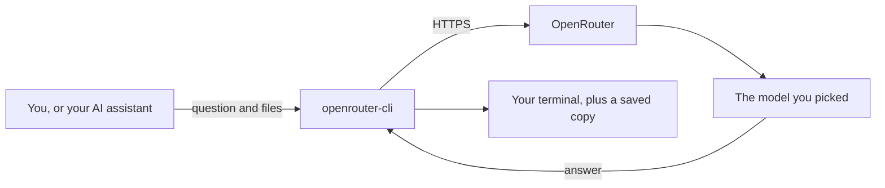

<div align="center">

# openrouter-cli

**Ask any AI model on [OpenRouter](https://openrouter.ai) to check your plan or your code, right from your terminal.**

[](#update-or-uninstall)
[](LICENSE)
[](#reference)
[](#before-you-start)

[What it does](#what-it-does) ·
[Install](#install) ·
[Sign in](#sign-in) ·
[First question](#ask-your-first-question) ·
[Costs](#what-costs-money) ·
[Privacy](#privacy-and-safety) ·
[Problems](#when-something-goes-wrong) ·
[Reference](#reference)

</div>

## What it does

[OpenRouter](https://openrouter.ai) is a service that gives you **one account for hundreds of AI models** from many different companies. `openrouter-cli` is a small program that sends your question, along with any files you choose, to one of those models. The answer appears in your terminal as the model writes it.

Out of the box, your question is sent exactly as you wrote it. Add `--role review` and the model plays the part of a **careful reviewer** instead: it reads your plan or code and replies with a verdict, then a list of problems ordered from most to least serious. Each problem says *where* it is, *why* it matters and *how* to fix it.

It was made for people who work with AI coding assistants such as Claude Code and Codex, so the assistant can ask a *different* model to double-check its work. It is just as handy when you type the commands yourself.



Here is what you can expect from it:

- You pick a model by its exact ID, by a few words of its name, or by a short nickname you save.
- You can see a model's prices **before you spend a cent**. Searching for models and checking prices is .
- Your OpenRouter key is stored ***encrypted***. The program has no way to save it as plain text.
- Every answer is saved to a file on your computer, and every charge goes into a local cost log.
- Follow-up questions can continue the same conversation.
- Private routing is on by default. How long a request may be kept depends on your OpenRouter privacy settings and the provider's policy ([details](#privacy-and-safety)).

## Before you start

You will need:

- [ ] A **Linux** computer with a 64-bit Intel or AMD processor (*x86-64*) and the standard GNU C library (*glibc*). Ubuntu, Debian, Fedora and Arch all use glibc.
- [ ] **systemd 256 or newer**, which is what encrypts your key. Type `systemctl --version` to see yours.
- [ ] An **OpenRouter account** from [openrouter.ai](https://openrouter.ai). Paid questions need credits on that account.
- [ ] These build tools: **git**, **Clang** with C++26 support, **CMake 4.0 or newer**, **Ninja**, the **OpenSSL 3 or 4** development files, the static C++ runtime library and **binutils**.
- [ ] An internet connection the first time you build. The build downloads a few libraries from GitHub, pinned to exact versions and checked against known fingerprints (SHA-256).

On **Ubuntu 26.04**, this command installs the build tools:

```bash
sudo apt install git clang cmake ninja-build libssl-dev libstdc++-15-dev binutils
```

On other distributions, install the matching packages with your package manager.

*Not sure your compiler is new enough?* Just try the build. It checks the compiler before it does anything else and stops with a plain message if something is missing.

## Install

Copy and paste these three lines into a terminal:

```bash
git clone https://github.com/slyfox1186/openrouter-cli.git
cd openrouter-cli
scripts/build.sh
```

The build script does all of this for you:

1. Finds the newest Clang on your computer.
2. Builds the program.
3. Runs its self-tests. They run *offline* against a pretend server, so they never use a real key and **never cost money**. Some tests wait for timeouts on purpose, so give them a few minutes.
4. Installs the program as `~/.local/bin/openrouter-cli`, but only if every step passed.

Now check that it worked:

```bash
openrouter-cli --version
```

You should see `openrouter-cli 0.1.0`.

<details>
<summary><b>It says "command not found"</b></summary>

<br>

Your shell does not look in `~/.local/bin` yet. Add it to your search path, then open a new terminal:

```bash
echo 'PATH="$HOME/.local/bin:$PATH"' >> ~/.bashrc
echo 'export PATH' >> ~/.bashrc
```

Using Zsh? Put the same two lines in `~/.zshrc` instead. Using Fish? Run `fish_add_path ~/.local/bin` once.

</details>

## Sign in

Run this once:

```bash
openrouter-cli login
```

The program walks you through four steps:

1. It prints a link. Open it in a web browser. *Using SSH?* The browser can be on any computer.
2. Sign in to OpenRouter and approve access.
3. Copy the code that the browser shows you.
4. Paste the code back into the terminal and press <kbd>Enter</kbd>.

That's it. OpenRouter creates a new key for this computer, and `openrouter-cli` stores it encrypted. To confirm you are signed in:

```bash
openrouter-cli status
```

**Already have an OpenRouter key?** Run `openrouter-cli auth set` and paste it when asked. Nothing you type is shown on screen.

**Never put your key on a command line, in a settings file or in an environment variable.** Those places can leak it, and the program refuses a key it finds in its settings file.

## Ask your first question

**Step 1.** Search for a model. This is  and needs no key.

```bash
openrouter-cli find "gemini"
```

**Step 2.** Look at its prices and limits. Also .
Replace `AUTHOR/MODEL` with an exact ID from the search results. An ID is the model's name at OpenRouter: who makes it, a slash, then the model, as in `google/gemini-4-argon`. It is not a folder on your computer.

```bash
openrouter-cli show AUTHOR/MODEL
```

**Step 3.** Give it a short nickname so you never have to type the full ID again. The examples on this page use the nickname `reviewer`, which only works after this step.

```bash
openrouter-cli save reviewer AUTHOR/MODEL
```

**Step 4.** Ask your question. This one is  unless the price from step 2 was zero.

```bash
openrouter-cli -m reviewer "Explain what a race condition is in three sentences."
```

Here `-m` picks the model, and the question goes out as written. Add `--role review` to have the model review whatever you send it, which is what the review recipes below do with your own files.

### What you will see

The answer appears in your terminal as the model writes it. Models that "think" first can take **several minutes**, and that is normal: their thinking is not shown, so nothing appears until the answer itself begins. While you wait, progress lines tell you how far the call has got:

```text
openrouter-cli: asking AUTHOR/MODEL (role plain, effort high, up to 64000 output tokens, zdr)
openrouter-cli: response stream started after 0.8s; reasoning text is excluded, so the answer can take a while
openrouter-cli: provider reported: PROVIDER
openrouter-cli: 10s, no answer text yet, 420 bytes of keep-alive and metadata received
openrouter-cli: answer started after 41s
```

A progress line appears every 10 seconds for the first minute and every 30 seconds after that. Once the answer is being written the lines stop, unless the text pauses for a whole interval. The provider line appears only when OpenRouter names the provider before the answer begins.

When the answer is finished, one last line shows the price, which model and provider answered, how many tokens were used and where the answer was saved:

```text
openrouter-cli: cost ... | MODEL via PROVIDER | in ... (cached ...) | out ... (reasoning ...) | answer /path/to/answer.md
```

In a terminal a blank line sits above and below the answer, and the progress lines are dimmed, so the answer is easy to pick out:

```text
openrouter-cli: answer started after 41s

A race condition happens when two parts of a program ...

openrouter-cli: cost ... | MODEL via PROVIDER | ...
```

Those blank lines are only for reading. The answer and the `openrouter-cli:` lines travel on separate channels (stdout and stderr), so `> answer.md` and pipes receive the answer alone, and the saved answer file never contains them.

## Everyday recipes

**Options always go first, and your question always goes last.** Swap the file names in these examples for your own files.

**Review several files at once.** `--role review` turns on the reviewer. Repeat `-f` for each file. Lines are numbered, so the reviewer can point at exact lines.

```bash
openrouter-cli -m reviewer --role review -f src/http.cpp -f src/http.hpp "Review the retry logic."
```

**Review your latest code changes.** A `-` in place of the question reads it from the pipe.

```bash
git diff | openrouter-cli -m reviewer --role review -
```

`git diff` only shows unstaged changes to files git already tracks, so it can print nothing, and an empty question is refused. To send the changes from your last commit instead (the repository needs at least two commits):

```bash
git diff HEAD~1 HEAD | openrouter-cli -m reviewer --role review -
```

**Send a long question.** Type it between the two `EOF` lines.

```bash
openrouter-cli -m reviewer --role review -f plan.md - <<'EOF'
What I am trying to do, what I changed,
and what I want you to check...
EOF
```

**Ask an ordinary question.** Leave `--role` out and the model answers in its own words, with no review format:

```bash
openrouter-cli -m reviewer "Explain this design."
```

**Have a back-and-forth conversation.** Give it a name with `--session`. Later rounds use the same model automatically, so leave out `-m`.

```bash
openrouter-cli -m reviewer --role review --session review -f plan.md "Review this plan."
openrouter-cli --session review -f plan.md "I fixed the second problem. Review the updated plan."
```

The session remembers the conversation and the role it started with, but **it does not reread your files**. Attach a changed file again with `-f`. *Each round resends the whole conversation*, so later rounds can cost more than earlier ones.

**Choose a specific provider.** Copy a tag from the `TAG` column of `show MODEL` and put it after the model with a colon:

```bash
openrouter-cli -m AUTHOR/MODEL:TAG "Review this plan."
```

The tag is everything after the **last** colon, so a nickname works too (`-m reviewer:TAG`). `-p TAG` does the same and can be repeated to allow several providers, but `:TAG` and `-p` cannot be used together. A model whose exact ID already has a colon, such as `AUTHOR/MODEL:free`, is used whole, and `AUTHOR/MODEL:free:TAG` adds a tag to it. OpenRouter's variant words (`:nitro`, `:floor`, `:exacto`, `:online`, `:thinking`, `:extended`, `:batch`) are refused rather than treated as tags; any other word after the last colon is read as a tag, and the progress line shows it before the answer starts.

**Save a provider for a model.** `pin` remembers the provider, so every later question to that model uses it, whether you name the model by ID, nickname or plain words, and in every round of a `--session`:

```bash
openrouter-cli pin AUTHOR/MODEL TAG          # one or more tags; replaces any saved before
openrouter-cli list                          # nicknames, then every saved provider
openrouter-cli -m AUTHOR/MODEL --any-provider "Q"   # ignore it for one question
openrouter-cli unpin AUTHOR/MODEL            # forget it
```

A `:TAG` or `-p` on one question replaces the saved provider for that question only. `--any-provider` sends no provider list at all, so OpenRouter chooses; your privacy setting still applies. A saved provider belongs to the exact model ID it was saved for: it stays when you remove that model's nickname, and it does not move when a nickname or an `~author/family-latest` ID later points somewhere else. `show MODEL` shows the saved provider, if any. `unpin` also accepts the exact ID that `list` prints, which clears a provider saved for a model that has since left OpenRouter's list.

**Ask a group of models at once.** Save a group once, with the models separated by commas, then ask every member with `-g`:

```bash
openrouter-cli group add coding "google/gemini-4-carbon,moonshotai/kimi-k3.1-pro"
openrouter-cli -g coding --role review -f plan.md "Review this plan."
```

Every member is asked at the same time, and **each one is a separate paid question**. Before anything is sent, every member is checked (its model, its provider, your options and any session), so a mistake stops the whole group for free. Each answer is printed under a `===== MEMBER (MODEL) =====` line as it finishes, the progress lines of each member start with `[MEMBER]`, and a summary at the end says which members completed. A member can carry its own provider (`AUTHOR/MODEL:TAG`), and a provider saved with `pin` applies to its model as usual. `-g` cannot be combined with `-m` or `-p`.

```bash
openrouter-cli group list                              # every group and its members
openrouter-cli group add coding "deepseek/deepseek-v4.1-flash-1017"   # add a member
openrouter-cli group remove coding "moonshotai/kimi-k3.1-pro"         # remove a member
openrouter-cli group remove coding                     # remove the whole group
```

A group has at most 8 members and asks each model once. Quote the list when it contains spaces. `group remove` matches members exactly as `group list` prints them.

With `--session NAME`, each member keeps its own conversation. For the next round, repeat `-g` and `--session` and leave out `--role` and `-s`, just like a one-model session. Once a group conversation has started, every member it asks must already have history in it; after adding a member, start a new session name.

If some members fail, the others' answers are still shown. **Never run the whole group again just because one member failed**: ask only that member again with `-m`, after checking `openrouter-cli spend`.

**Ask a question that starts with a dash** or matches a command name. Put `--` in front of it:

```bash
openrouter-cli -m reviewer -- "--force: is this flag safe?"
```

## What costs money?

| What you run | Cost |
| --- | --- |
| A question: `openrouter-cli -m MODEL "..."` |  |
| Each follow-up round in a `--session` |  |
| A group question: `openrouter-cli -g NAME "..."` | , once per member |
| `find`, `show`, `save`, `remove`, `list`, `pin`, `unpin`, `group add`, `group remove`, `group list` |  |
| `status`, `account balance`, `account keys`, `account credits`, `account activity` |  |
| `spend`, `spend --resolve` |  |
| `login`, `logout`, `auth set`, `--help`, `--version` |  |

A question costs whatever the model's published price says, so it is free only when `show` lists a price of zero.

**A paid question is never retried automatically**, because a retry could charge you twice. If a question fails, the program tells you, and you decide whether to try again.

### Keep an eye on spending

```bash
openrouter-cli spend              # everything so far
openrouter-cli spend --since 7d   # the last 7 days (also: today, 30d, all)
openrouter-cli spend --resolve    # look up charges that were not known yet
openrouter-cli account balance    # usage and limit of your key
```

Sometimes OpenRouter reports a charge a little later. Until then the cost shows as *unknown*, which is different from zero. `spend --resolve` fetches it for free.

<details>
<summary><b>See your whole account (needs a Management key)</b></summary>

<br>

OpenRouter offers a separate *Management key* in its settings. With one, you can list every key on your account, see credits bought and used, and see usage by day, model and provider. The Management key is **only used for these account commands** and is never sent with a question.

```bash
openrouter-cli auth set --management
openrouter-cli account keys
openrouter-cli account credits
openrouter-cli account activity --days 7
```

`--days` accepts 1 to 30 completed UTC days (default 30).

Create the key on OpenRouter's [Management keys](https://openrouter.ai/settings/management-keys) page. An ordinary API key does not work here, and `auth set --management` refuses one. When OpenRouter turns down an account request, the error shows the reason OpenRouter gave.

</details>

## Privacy and safety

**Your key is encrypted.** It is stored with [systemd-creds](https://www.freedesktop.org/software/systemd/man/latest/systemd-creds.html), which locks it to *your user account on this computer*. A copy on another computer will not open, so sign in separately on each computer. If encryption is not available (some containers, for example), the program stops with an error rather than saving your key unprotected.

**It sends what you give it.** Your question, your extra instructions, the conversation history and every attached file go to OpenRouter exactly as they are. Nothing is scanned for passwords or keys, and files such as `.env` are attached like any other file, so *look at what you send*.

**Private routing is on by default.** The default setting, `--privacy zdr`, only uses providers that do not train on your data and are listed as *zero data retention* (ZDR). Your OpenRouter privacy settings may also allow *Safety Retention* providers, which may keep requests. What is kept in the end depends on those settings and on each provider's policy. Read [OpenRouter's privacy guide](https://openrouter.ai/docs/guides/features/zdr) before sending sensitive material. If a model has no zero-retention provider, `--privacy no-training` lets you use it, but that provider may keep your request.

**Your history stays on your computer** as plain text files. Key encryption does not cover your saved questions and answers.

**It never prints your key** or the text of your requests, and it hides raw error messages from providers. Model names and other details it shows have hidden terminal control codes made harmless; the answer itself is shown unchanged.

## Using it with Claude Code or Codex

The project includes an optional *skill* that teaches AI coding assistants how to use the program. To install it, build with:

```bash
scripts/build.sh --with-skills
```

This links the skill into `~/.agents/skills/openrouter-cli` and `~/.claude/skills/openrouter-cli`. You can then say something like *"ask Gemini to review this plan"* to your assistant.

The skill tells the assistant to show you the model and its prices and to wait for your approval before a paid question, unless you have given it standing permission, for example in your `CLAUDE.md` or `AGENTS.md`. Any spending limits and funds checks you require still apply. It also tells the assistant never to touch your keys.

*Keep the cloned folder where it is*, because the skill links point into it.

## When something goes wrong

Every command explains itself with `-h` or `--help`, for example `openrouter-cli spend --help`.

When a command fails, it prints a short message and ends with an *exit code*. Your shell shows the code of the last command with `echo $?`.

| Code | What happened | What to do |
| :---: | --- | --- |
| **0** | It worked. | Nothing. |
| **1** | Something unexpected went wrong inside the program. | Read the message. Report it if it repeats. |
| **2** | The command was typed wrong. | Check `openrouter-cli --help`. Remember: options first, question last. |
| **3** | Stopped before sending. The input was too big, the session was busy, or the cost log could not be written.  | Send less, or wait for the other question in that session to finish. |
| **4** | The model name was not found or matched more than one model, the group or member was not found, or `unpin` found no saved provider. | Pick one of the printed choices, or use the exact ID. `list` and `group list` show what is saved. |
| **5** | OpenRouter or the network had a problem, the key was rejected, or no provider matched your model, provider and privacy choices. | Read the message. For "no provider", check the tags with `show`; a saved provider is cleared with `unpin` or skipped with `--any-provider`. Trying again is another paid question. |
| **6** | The answer was cut short, for example because it ran out of room. | Any partial answer is kept in the answer file named in the message, unless the message says saving failed. When it ran out of room, the message says how much went to thinking and to the answer when OpenRouter reports those counts, and whether a higher `--max-output-tokens` can help or only a lower `-e` or less input. Trying again is another paid question. |
| **7** | A setup problem, such as no key stored, a key that cannot be decrypted, a key found in the settings file, a bad setting, or a damaged `models.json`, `providers.json` or `groups.json`. | For a key problem, run `openrouter-cli status` and follow what it says. For a damaged file, the message names it: fix or remove that entry. While `providers.json` is damaged, `-p`, `:TAG` and `--any-provider` still work for one question. |
| **8** | You interrupted it (for example with <kbd>Ctrl</kbd>+<kbd>C</kbd>), while the answer was arriving or while the cost was being looked up. | Any partial answer is kept in the answer file named in the message, unless the message says saving failed. |
| **9** | The answer arrived, but saving the answer, cost or session failed.  | Use the answer shown on screen. **Do not just run it again.** |

For a group question (`-g`), the code is 8 when it was interrupted, 1 when a member ended unexpectedly, 0 when every member completed, and otherwise the code of the first member that did not complete. The summary lines show what happened to each member, and each member's cost line shows what it charged.

After any failed paid question, look at the saved answer and at `openrouter-cli spend` *before* deciding to ask again. If an interruption, a network failure or a cut-short answer also had a saving problem, the program reports code 8, 5 or 6 rather than 9. If an interruption cuts short the final cost bookkeeping, the program waits at most two seconds for its log locks and tells you about any record it could not save.

## Update or uninstall

**To update**, get the latest code and build again:

```bash
git pull
scripts/build.sh
```

The new version replaces the old one in a single step.

**To uninstall**, run this from the cloned folder:

```bash
scripts/build.sh --uninstall
```

If you installed with `--bin-dir`, pass the same `--bin-dir` again. Uninstalling removes the program and the skill links. It leaves your keys, settings, history and cost log where they are.

To remove your stored keys as well, run `openrouter-cli logout` **before** uninstalling. Your key still works at OpenRouter until you delete it in your [OpenRouter key settings](https://openrouter.ai/settings/keys).

## Reference

Everything below is optional detail. Click a heading to open it.

<details>
<summary><b>All commands</b></summary>

<br>

| Command | What it does |
| --- | --- |
| `openrouter-cli [OPTIONS] QUERY` | Ask a question. `-` as the query reads it from standard input. |
| `find [--refresh] WORDS` | List models matching the words. `--refresh` downloads a fresh model list first. |
| `show MODEL` | Prices, context and output limits, the default output budget, reasoning efforts and provider tags. |
| `save ALIAS MODEL_ID` | Save a nickname for an exact model ID. A model has one nickname, so a new one replaces the old. |
| `remove ALIAS` | Delete a saved nickname. |
| `list` | List saved nicknames, then every saved provider. |
| `pin MODEL TAG...` | Save the providers every later question to that model uses. Replaces earlier tags. |
| `unpin MODEL` | Forget a model's saved provider. Accepts the exact ID `list` prints. |
| `group add NAME MODELS` | Create a group or add members. MODELS is one argument with commas, such as `"A/B,C/D:TAG"`. |
| `group remove NAME [MODELS]` | Remove the listed members, or the whole group when none are given. |
| `group list` | Every group and its members. |
| `spend [--since PERIOD] [--resolve]` | Totals from the cost log. PERIOD is `today`, `7d`, `30d` or `all`. |
| `login [--replace]` | Sign in with your browser and store a new key. |
| `logout [--management]` | Delete stored keys from this computer. `--management` deletes only the Management key. |
| `auth set [--management] [--replace]` | Store an existing key, typed at a hidden prompt or piped in. |
| `status` | Who is signed in, plus key usage and limits. |
| `account balance` | Usage and limit of your key. |
| `account keys` | Every key on your account (Management key). |
| `account credits` | Credits bought and used (Management key). |
| `account activity [--days N]` | Usage per day, model and provider (Management key). |

`find`, `show`, `save`, `remove`, `list`, `pin` and `unpin` also work with `models` in front, for example `openrouter-cli models save ALIAS MODEL_ID`.

`login` and `auth set` never overwrite a stored key unless you add `--replace`. Keys are checked with OpenRouter before they are stored. Deleting a key from this computer does not delete it at OpenRouter.

**How model names are matched.** `-m` accepts an exact ID, a saved nickname, an `~author/family-latest` ID or plain words. An exact ID wins over a nickname, and a nickname wins over plain words. Plain words that match exactly one model are used without saving anything. Only `save` creates a nickname. The model list is cached; if an automatic refresh fails, the old list is used with a dated warning, but a failed `--refresh` is reported as an error.

</details>

<details>
<summary><b>All question options</b></summary>

<br>

| Option | What it does |
| --- | --- |
| `-m`, `--model MODEL[:TAG]` | The model: nickname, exact ID, `~author/family-latest` or plain words. `:TAG` after it uses only that provider for this question. |
| `-g`, `--group NAME` | Ask every model in a saved group at once, one paid question per member. Not combined with `-m` or `-p`. |
| `-f`, `--file FILE` | Attach a file, sent with line numbers. Repeat for more files. |
| `--role ROLE` | `plain` (default) sends your question as written. `review` asks for a structured review. |
| `-s`, `--system-prompt TEXT` | Extra instructions for the model, sent as its system prompt. `-s @FILE` reads them from a file. |
| `-e`, `--effort LEVEL` | How hard the model thinks: `max`, `xhigh`, `high`, `medium`, `low`, `minimal` or `none`. Models that cannot choose ignore it. |
| `--max-output-tokens N` | Most tokens the model may write, thinking included, up to the model's own limit. Leave it out to use the default (`OPENROUTER_CLI_MAX_OUTPUT_TOKENS`); a smaller number can cut the answer off while its thinking is still billed. |
| `-p`, `--provider TAG` | Use only this provider for this question, replacing a saved one. Copy tags from `show`. Repeat for more. Not combined with `:TAG`. |
| `--any-provider` | Ignore the saved provider for this question and let OpenRouter choose. Your privacy setting still applies. |
| `--privacy MODE` | `zdr` (default) or `no-training`. See [Privacy and safety](#privacy-and-safety). |
| `--session NAME` | Keep the conversation under this name for follow-ups. |
| `-h`, `--help` | Show help. |
| `--version` | Show the version. |

A session remembers its first model and instructions, and only complete answers are added to it. It does not remember a `:TAG` or `-p`; use `pin` when every round should use one provider. Answers go to standard output and are saved as `answers/<call_id>.md` in the state folder. Progress lines and the final cost line go to standard error. If writing those messages fails, the answer and the cost record are still saved. A group question (`-g`) is the exception: standard output holds one block per member, each printed when that member finishes rather than as it is written.

</details>

<details>
<summary><b>Build script options</b></summary>

<br>

| Option | What it does |
| --- | --- |
| `--check` | Also run formatting checks, debug tests with memory and undefined-behavior sanitizers, `clang-tidy` and `cppcheck`. Needs those tools installed; versioned Clang tools (such as `clang-tidy-23`) are preferred. |
| `--portable` | Build code that runs on any x86-64 processor. Without it, the program is tuned to the processor of the computer that builds it and may not start on an older one. |
| `--no-install` | Build and test without installing. |
| `--quick` | Build and check library linking only. No tests, no install. Cannot be combined with `--check`. |
| `--with-skills` | Also link the optional assistant skill. |
| `--bin-dir DIR` | Install the program into DIR instead of `~/.local/bin`. |
| `--force` | Replace or remove a file the script cannot confirm it installed. Look at the file first. |
| `--fresh` | Throw away earlier build settings. Needed once when upgrading from an older build that used static OpenSSL, in a `--check` run as well, because only `--check` sets up the debug build. |
| `--jobs N` | Number of parallel build jobs (default: number of CPUs). |
| `--list-compilers` | Show the Clang versions found and which one would be used. |
| `--uninstall` | Remove the program and skill links without building. |
| `--no-skill` | With `--uninstall`, leave the skill links in place. |
| `-h`, `--help` | Show help. |

Each build run writes a log to `build/logs/build-<UTC time>-<unique>.log`, and `build/logs/latest.log` always points to the newest one. Build folders are `build/release-clang-<version>` and `build/debug-clang-<version>`.

Next to the program, the installer keeps a small receipt, `~/.local/bin/.openrouter-cli.sha256`, so later upgrades and uninstalls know which file is theirs. Unknown files and symlinks need `--force`. Folders and other special files are always refused. Skill files are never replaced. An install from before receipts existed may need `--force` after you have checked the file.

</details>

<details>
<summary><b>Settings</b></summary>

<br>

Settings are optional. The settings file lives at `$XDG_CONFIG_HOME/openrouter-cli/config.env`, or `~/.config/openrouter-cli/config.env` when `XDG_CONFIG_HOME` is not set. To create it from the included template without overwriting an existing file, run this from the cloned folder:

```bash
config_base="${XDG_CONFIG_HOME:-}"
case "$config_base" in /*) ;; *) config_base="$HOME/.config" ;; esac
install -d -m 700 "$config_base/openrouter-cli"
(umask 077; set -C; cat .env.example > "$config_base/openrouter-cli/config.env")
```

Then edit the file. Exported environment variables with the same names do **not** override it.

| Setting | Default | Meaning |
| --- | --- | --- |
| `OPENROUTER_CLI_BASE_URL` | `https://openrouter.ai/api/v1` | API address. Change only for an OpenRouter regional domain. |
| `OPENROUTER_CLI_APP_REFERER` | empty | Optional app link sent to OpenRouter. Empty sends none. |
| `OPENROUTER_CLI_APP_TITLE` | `openrouter-cli` | App name shown in your OpenRouter activity. |
| `OPENROUTER_CLI_APP_CATEGORIES` | `cli-agent` | App category sent to OpenRouter. |
| `OPENROUTER_CLI_DEFAULT_EFFORT` | `high` | Effort used when `-e` is not given. |
| `OPENROUTER_CLI_MAX_OUTPUT_TOKENS` | `64000` | Output budget, thinking included, capped at each model's limit. It is a fixed number because a model's listed maximum is often a placeholder, and some models switch to a multi-part reply mode above their real per-answer limit. `show` prints the budget a model gets. |
| `OPENROUTER_CLI_PRIVACY` | `zdr` | Default privacy mode. |
| `OPENROUTER_CLI_CATALOG_TTL_HOURS` | `24` | Hours before the cached model list is refreshed. |
| `OPENROUTER_CLI_IDLE_TIMEOUT_SECONDS` | `300` | Give up when no data is sent or received for this long. |
| `OPENROUTER_CLI_TOTAL_TIMEOUT_SECONDS` | `3600` | Longest a single question may take. |
| `OPENROUTER_CLI_MAX_FILE_BYTES` | `1048576` | Largest single attached file (1 MiB). |
| `OPENROUTER_CLI_MAX_INPUT_BYTES` | `4194304` | Largest total input per question (4 MiB). |

The API address must use HTTPS; plain HTTP is allowed only for exact local loopback addresses used in testing. Addresses with user names, queries or fragments are refused, and so are header settings containing control characters. A key in the settings file is refused; store it with `login` or `auth set`, then delete the old line without displaying it.

</details>

<details>
<summary><b>Where files are stored</b></summary>

<br>

| What | Where |
| --- | --- |
| Settings | `$XDG_CONFIG_HOME/openrouter-cli/config.env`, or `~/.config/openrouter-cli/config.env` |
| Everything else | `$XDG_STATE_HOME/openrouter-cli/`, or `~/.local/state/openrouter-cli/` |
| Cost log | `costs.jsonl` inside that state folder |

The state folder holds `catalog.json` (cached model list), `models.json` (nicknames), `providers.json` (providers saved with `pin`), `groups.json` (groups), `credentials/` (encrypted keys), `answers/`, `sessions/`, `group-sessions/` (one marker per group conversation) and `locks/`. Builds older than `pin` and `group` leave `providers.json` and `groups.json` untouched but do not use them.

Relative `XDG_*` values are ignored, and `HOME` must be an absolute path when it is needed. Reading settings never creates folders. Folders are private to you (mode 700) and files the program creates are too (mode 600).

A saved session can be up to 128 MiB, and stored encrypted key data up to 64 KiB. If saving a session fails before the old file is replaced, the old session is kept and the answer is still saved on its own. If the replacement succeeds but the final disk sync fails, the message says the save may not be durable.

The cost log records each paid question *before* it is sent, then its generation ID, result and final cost. Damaged lines in the log are reported, and the valid records are still used. Records without a generation ID may stay unresolved; check `account activity` for those.

</details>

<details>
<summary><b>Moving from an older checkout</b></summary>

<br>

Older versions kept their settings in a `.env` file and their data in a `state/` folder inside the checkout. To keep using them where they are, set an absolute path:

```bash
OPENROUTER_CLI_HOME=/absolute/path/to/old/checkout
export OPENROUTER_CLI_HOME
```

A relative path is an error. The cost log stays in the normal state folder either way, and nothing is moved automatically.

To move the files instead, on the same computer:

1. Stop any running questions and make a private backup.
2. Copy the old `.env` to the new `config.env` path, and the contents of the old `state/` to the new state folder. Never overwrite or merge a file that already exists there, especially the cost log, keys, sessions or nicknames. Keep ownership and private permissions.
3. Unset `OPENROUTER_CLI_HOME`, then check `openrouter-cli status` and `openrouter-cli list`.
4. Keep the old files until you are sure everything works.

Encrypted keys only open for the same user on the same computer. On a new computer, sign in again instead of copying them.

</details>

<details>
<summary><b>Colors</b></summary>

<br>

Help text and the sign-in steps use your terminal's colors. Set `NO_COLOR` to any nonempty value to turn color off; it wins over everything else. Set `CLICOLOR_FORCE=1` to keep color on when output is piped. Piped help is wrapped to `COLUMNS` characters, or 80 when that is not set.

</details>

<details>
<summary><b>How it is built</b></summary>

<br>

`openrouter-cli` is written in C++26 and builds with Clang only. Configuration checks that your compiler and standard library have the C++26 features the code uses (including `std::expected`, `std::print`, `std::format`, `std::flat_map`, `std::ranges::to`, `std::views::enumerate`, saturation arithmetic and `std::jthread`) before anything is downloaded. Building also needs Bash, GNU coreutils, `find`, `sort`, `readelf` and `ldd`.

Release builds are tuned to the processor of the computer that builds them (`-march=native`), so a program built on one computer may not start on an older one; `--portable` builds for any x86-64 processor instead. Release builds use `-O2` and link-time optimization (ThinLTO) when the toolchain supports it, including for the bundled libcurl. All compiled code, the bundled libcurl included, uses the hardening options of the OpenSSF compiler hardening guide, plus frame pointers so profilers and debuggers can follow the call stack. The build checks that the program carries the Intel CET compatibility marking (IBT and shadow stack); whether CET is actually enforced depends on the processor, kernel and system libraries. The program needs glibc 2.36 or later. If `ccache` is installed, the build uses it. Compiler warnings are shown but do not stop a normal build, so a newer compiler cannot keep you from installing; `--check` treats warnings in this project's own code as errors. libcurl's threaded DNS resolver is kept on. libcurl and the C++ runtime are linked in statically, while OpenSSL 3 or 4 and glibc come from your system; static OpenSSL is not supported. The build refuses binaries with an embedded RPATH or RUNPATH and checks that the system's normal library loader finds the right OpenSSL.

At run time, the commands that use a key also need `systemd-creds` on your `PATH` and a working systemd user credential service. A recent systemd version alone does not guarantee that, for example inside a container.

Development used Clang 23.1.5 with GCC 15's libstdc++ and OpenSSL 3.5 on Ubuntu Linux and systemd 259. It also builds and passes its tests with Clang 23.1.4, GCC 16's libstdc++ and OpenSSL 4.1 on Arch Linux. These are known working versions, not minimum requirements.

**For contributors.** `scripts/build.sh --check --no-install` runs every check without installing.

</details>

## License

Released under the [MIT License](LICENSE). Copyright 2026 Jeff Hollis.
The licenses of the libraries it uses are listed in [THIRD_PARTY_NOTICES.md](THIRD_PARTY_NOTICES.md).
